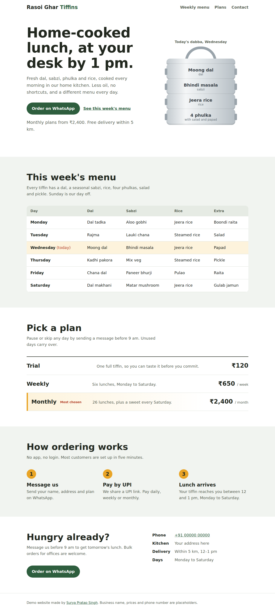

# Tiffin Service Website

A fast, mobile-friendly one-page website for a small home tiffin (lunch delivery) business. Built with plain HTML, CSS and a little JavaScript, with no frameworks and no build step, and hosted free on GitHub Pages.

**Live demo:** https://surya-7348.github.io/tiffin-service-website/

*Demo project. The business name, prices and phone number are placeholders.*

## Features

- **Today's tiffin, updated automatically**: the hero shows a stacked steel tiffin with today's dishes, picked from the weekly menu using the current day. On Sunday it shows Monday's menu.
- **Weekly menu table** with today's row highlighted
- **Plans and pricing**: trial, weekly and monthly
- **One-tap WhatsApp ordering** with a pre-filled message
- **Responsive**: works on phones, tablets and desktops
- **Accessible**: visible keyboard focus, and the animation is switched off for users who prefer reduced motion

## Customize it for a real business

Everything lives in `index.html`:

- **Menu**: edit the `menu` list inside the `<script>` tag at the bottom. The hero and the table both update from it.
- **Prices and plans**: edit the `Pick a plan` section.
- **WhatsApp and phone**: replace `910000000000` with the real number (country code + number, no `+` or spaces).
- **Colors**: change the variables at the top of the `<style>` block (`--leaf`, `--haldi` and so on).

## Run locally

Download the repo and open `index.html` in any browser. No installation is needed.

## Built with

HTML5 · CSS (Grid, Flexbox, custom properties) · vanilla JavaScript · GitHub Pages
